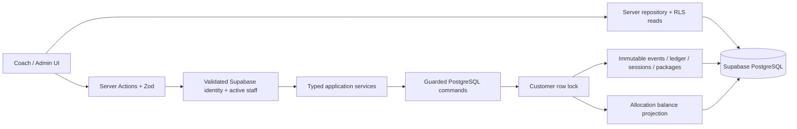
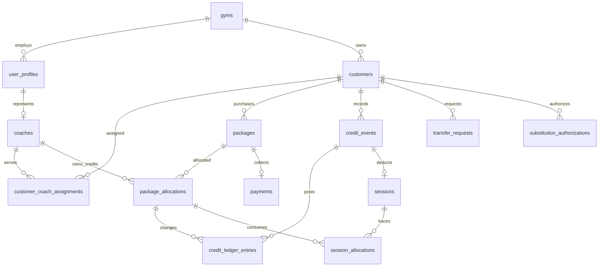

# Architecture

## Boundaries and data flow

The app is one Next.js deployment and one Supabase project. No queues, Redis, workers, online payment provider, or microservices are required. The browser receives only authorized view data, form options, and safe action results. Credentials with elevated database access live only in server-only modules or local administrative scripts.

`commandSchemas` is the public typed application input contract. `executeCommand` independently checks the current staff role, validates a command with Zod, and calls `gym_command(operation, input, key)` with the caller's session. Database commands derive the actor and gym from `auth.uid()` and the active staff profile; incoming authority/tenant fields are never trusted. SQL constraints and command guards remain authoritative even when the server UI is bypassed.

## Relationships

Customer identities do not require an Auth account. Coach IDs refer to staff profile IDs. Composite `(gym_id, id)` foreign keys prevent accidental cross-tenant references. Customer/coach deactivation preserves all facts. Assignment status controls future normal work without rewriting historic credit ownership.

Packages retain original price, quantity, date, original coach, currency, source kind, and external import ID. Current ownership lives in `package_allocations`, which is unique by package/current coach. Payment is a separate one-per-package fact. Sessions independently record the actual teacher and credit-owning coach; `session_allocations` snapshots quantity and price of every consumed lot.

## Transactional correctness

Every application mutation claims an actor-scoped durable idempotency key and verifies the stored operation/payload. It returns a committed previous result before considering new work. If execution fails, its receipt is rolled back with everything else.

Credit commands acquire `SELECT ... FOR UPDATE` on the customer before inspecting balances. This serializes all credit operations for that customer, including new package insertion, avoiding FIFO phantom allocations and overspending. Locks last until transaction completion. Different customers can execute concurrently.

The same transaction updates a nonnegative allocation projection, appends immutable signed ledger entries with after-balances, and inserts business records. Direct staff writes are revoked. FIFO ordering is `(original package purchased_at, package id)` and continues to apply after transfer. Package-level values remain distinguishable when mixed-price credits are transferred or consumed.

A transfer is one event with negative source and matching positive destination entries per package. It has no payment. Approval locks/reloads the request after locking the customer, preventing duplicate decisions. A substitution is a bounded, date-specific authorization with atomic consumption; it deducts the owner's lots while recording a different teacher. Session reversal restores the authorization's consumed capacity.

A reversal is a unique compensating event. It restores the exact original allocation deltas and retains the original event/session/package. It cannot reverse another reversal or make any allocation negative. Dependent usage must be reversed first when necessary. Reversing a purchase also changes the associated payment to voided. State changes to reconciliation retain actor, time, reason, and input/result audit entries.

Import batches lock the gym and then existing customers in stable ID order, resolve rows in dependency order, and commit atomically. Normal customer operations never acquire a gym lock after a customer lock, avoiding an inverted lock order. Batch source equality and external identifiers make repeated imports safe. Unknown-price opening credits do not fabricate receipts or sessions.

## Authorization

- `user_profiles` is the database authority for active staff role and tenant. A JWT cannot elevate a coach via editable metadata. Deactivation is checked on every command/read.
- Server identity is validated with Supabase `getUser`; cookie refresh uses the Next.js proxy. Authenticated responses are private/no-store. Server-side query caching is limited to the current React request.
- Exposed tables have RLS and read policies; all browser/staff direct financial and ledger writes are revoked. SQL functions are explicitly granted rather than relying on PUBLIC defaults.
- Public command wrappers use invoker security. Their private definer implementations pin an empty search path, schema-qualify relations, and independently check actor, tenant, role, ownership, assignments, and affected record IDs. The private schema is not exposed through the Data API.
- Coaches access assigned customer profiles and their own package allocations/payments/session history. Former coaches retain session name snapshots without regaining the full customer profile.
- `substitution_context` is an explicitly guarded security-barrier view: authorized substitutes get customer identity, active state, and the owning credit balance. It exposes neither private notes/contact details nor purchase prices. The underlying customer/package tables remain inaccessible to unrelated substitutes.
- Administrators access full operational/financial reports, imports, account invitations, and approvals. Export handlers check the role before loading report data.
- Elevated Auth account provisioning is isolated from normal commands. Its service-only RPC rechecks the initiating administrator and records the staff profile plus audit entry in one database transaction. Bootstrap serializes globally and closes after the first admin. The final active administrator cannot be deactivated.

## Reporting and currency

Amounts are integer minor units bounded below JavaScript's safe integer limit per financial fact. Decimal form amounts are parsed from digit strings. A gym has one currency; formatting/input use the configured ISO minor-unit scale (TWD defaults to two decimals). First bootstrap can select GYM_CURRENCY; non-TWD gyms configure their own tiers. Existing package currency cannot be rewritten by a setting change.

Cash follows payment date/status; delivery follows actual session date/instructor and consumed package prices. Current unused value follows current allocations. Unknown-price credits are counted separately. Complimentary credits are known zero. Transfers do not affect cash or total package value. Reversed attendance and voided payments remain visible but are excluded from current totals, including when an older reporting period is restated.

These are operational reports rather than accounting period close or revenue recognition. No salary/coach commission system is included. In-memory report aggregation is appropriate for this gym's size; a future larger dataset can move the same definitions to secured aggregate queries without changing the ledger.

## Future integration points

- **Customer portal / LINE:** introduce an identity-link table with stable customer ID, provider, subject, and verified linkage ownership. Do not match LINE display names or create a second customer table. Add customer-specific read authorization separately from staff RLS.
- **QR:** resolve a short-lived signed/replay-checked token to a customer ID. Then require an authenticated coach confirmation through the existing attendance command. Scanning alone must never authorize a debit.
- **Native apps:** expose secured typed API adapters around `executeCommand` (or a bearer-token equivalent actor adapter), preserving the same database command checks and idempotency keys.
- **Notifications:** add an explicit notification service behind committed event references when implemented. Do not send messages within the financial transaction; a later outbox can provide reliable delivery if needed. There is no unused messaging infrastructure in the MVP.
- **Payment providers:** add provider receipt references and settlement events rather than treating attendance/transfer as sales. An alternate credit activation policy needs an explicit command and migration design, preserving the posted historical ledger.

## Validation and operations

Pure domain tests cover validation, dates, money, CSV safety, and report definitions. The isolated PostgreSQL harness applies production migrations and tests real RLS/locks using Auth identity claims. Full browser tests use the actual Supabase Auth service and Data API, including denied signup and denied direct writes. CI requires both layers.

Keep migrations additive and validate on staging. Back up before rollout. Never repair production by editing immutable history; use audited compensating events. Runtime errors are surfaced without exposing database details or credentials; inspect server/Supabase logs and audit records for investigation. A production monitoring/alerting vendor is intentionally left to deployment operations.
